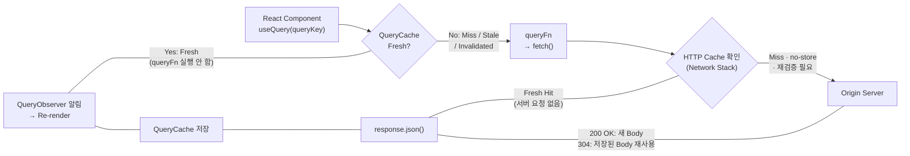
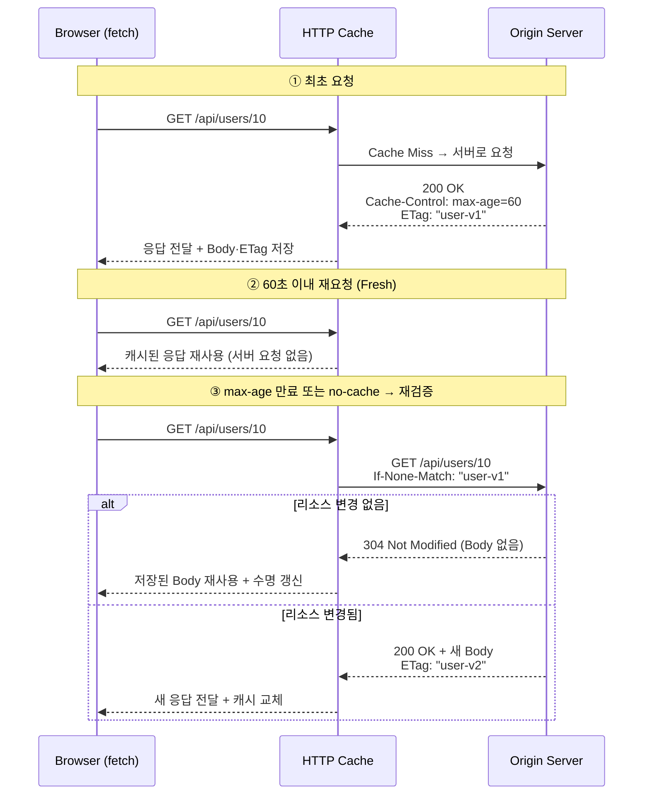

### 핵심 개념과 전체 동작 흐름

두 캐시는 동일한 서버 데이터를 서로 다른 계층에서 관리하는 독립적인 캐싱 시스템임

- **HTTP**
    - 브라우저 네트워크 계층에서 HTTP 응답을 재사용하여 네트워크 요청과 데이터 전송 비용을 줄임
- **Tanstack Query**
    - JavaScript 런타임에서 API 응답 데이터를 관리하여 불필요한 API 호출을 줄이고 UI 상태를 관리함

차이는 HTTP는 HTTP 응답을 저장하고, Tanstack Query는 애플리케이션에서 사용할 Query 데이터를 저장한다는 것임

→ HTTP는 브라우저 내부의 네트워크, Tanstack Query는 JavaScript 런타임의 Heap Memory

<br/>

그림으로 보면 다음과 같음



- Fresh한 데이터가 존재하면 `queryFn` 을 실행하지 않음
- 데이터가 없거나 `Stale` 상태라면 `queryFn` 을 실행함
- `queryFn` 에서 `fetch()` 를 호출하면 브라우저의 HTTP Cache가 개입함

즉, Tanstack Query에서 캐싱이 발생하면 HTTP Cache까지 내려가지 않을 수 있음

<br/>

캐시 키를 비교하자면 먼저 HTTP Cache에서는 브라우저가 URL과 요청 조건을 기반으로 기존 응답을 재사용할지 판단함

```sql
GET /api/users/10
```

<br/>

Tanstack Query는 Query key를 다르게 설정하면 별도의 캐시로 관리함

```tsx
useQuery({
	queryKey: ['users', 10],
	queryFn: () => fetchuser(10),
});
```

<br/>

다음처럼 Query Key를 다르게 설정하면 별도의 캐시로 관리함

```tsx
['users', 10]
['users', 20]
['users', 10, 'profile']
```

HTTP와 달리 URL이 같다고 같은 것은 아니며, URL이 달라도 동일한 Query Key를 사용하면 동일한 Query 캐시를 공유할 수 있음

<br/>
<br/>

### 각각의 캐시 동작 방식

먼저 HTTP Cache는 서버가 전달하는 `Cache-Control` 헤더를 기반으로 응답을 저장하거나 재사용함

```sql
HTTP/1.1 200 OK
Cache-Control: public, max-age=60
```

`max-age` 를 통해 Fresh한 응답을 설정할 수 있음

→ 60 설정시 60초 이내 동일한 요청이 발생하면 브라우저가 캐시된 응답을 재사용

<br/>

그외 다음과 같은 지시어도 존재함

- `no-cache`
    - 저장은 가능하지만 재사용하기 전에 서버 검증이 필요
- `no-store`
    - 요청 및 응답을 HTTP 캐시에 저장하지 않도록 함

<br/>

`max-age` 가 만료되었거나 `no-cache` 가 설정된 경우, 브라우저는 캐시된 응답을 바로 사용하지 않고 서버에 재검증을 요청함

이때 서버가 응답이 버전을 식별하기 위해 사용하는 값이 `ETag` 임

```sql
HTTP/1.1 200 OK
Cache-Control: no-cache
ETag: "user-v1"
```

<br/>

브라우저는 응답과 함께 `ETag` 를 저장해두고, 재검증 시 `If-None-Match` 헤더에 담아 서버로 바로 전달함

```sql
GET /api/users/10
If-None-Match: "user-v1"
```

<br/>

서버는 현재 리소스의 ETag와 비교하여 다음과 같이 응답함

- 변경 없음
    - `304 Not Modified`
- 변경됨
    - `200 OK` + 새로운 `Body` 와 새 `ETag`

<br/>

전체 과정을 보면 다음과 같음



<br/

Tanstack Query는 HTTP 헤더가 아니라 개발자가 설정한 Query 옵션으로 캐시의 상태와 수명을 관리함

```tsx
useQuery({
	queryKey: ['users', 10],
	queryFn: fetchUser,
	staleTime: 30_000,
	gcTime: 300_000,
});
```

- `staleTime`
    - 데이터를 가져온 시점부터 `staleTime` 동안 Fresh 상태임
    - Fresh 상태에서는 컴포넌트가 다시 마운트되어도 `queryFn` 을 실행하지 않음
- `gcTime`
    - Query를 구독하는 컴포넌트가 모두 언마운트되어 Incative 상태가 된 시점부터 계산함
    - `gcTime` 이 지나면 해당 Query 데이터를 캐시에서 삭제함
    - 5분 설정시 5분이 지난후 해당 Query가 Garbage Collection 대상이 됨

<br/>
<br/>

### 두 캐시가 충돌하는 상황

두 캐시의 수명과 무효화 규칙이 서로 독립적이기 때문에 다음과 같은 상황이 발생할 수 있음

다음 상황은 Query는 Stale이지만 HTTP Cache가 Fresh한 경우임

```tsx
// HTTP
Cache-Control: max-age=600

// Tanstack Query
useQuery({
	queryKey: ['users'],
	queryFn: fetchUsers,
	staleTime: 0,
});
```

Tanstack Query가 재요청했지만 실제 서버에는 요청이 전달되지 않을 수 있음

→ 오래된 데이터가 다시 저장될 수 있음

<br/>

다음은 Query는 Fresh이지만 HTTP Cache가 만료됨 경우임

```tsx
useQuery({
	queryKey: ['users'],
	queryFn: fetchusers,
	staleTime: 600_000,
});
```

즉, HTTP Cache가 만료되었더라도 Tanstack Query가 Fresh하다면 서버 요청 자체가 발생하지 않을 수 있음

<br/>

이러한 문제를 해결하기위해 최신 여부 판단은 Tanstack Query에만 맡기고, HTTP Cache는 재검증으로 전송량만 줄이는 역할로 나눠야함

```sql
HTTP/1.1 200 OK
Cache-Control: private, no-cache
ETag: "users-v10"
```

<br/>

```tsx
function useUsers() {
	return useQuery({
		queryKey: ['users'],
		// 보통은 따로 분리하지만 가독성을 위해 같이 둠
		queryFn: async () => {
			const response = await fetch('/api/users');
			
			if (!response.ok) {
				throw new Error('Failed to fetch users');
			}
			
			return response.json();
		},
		staleTime: 30_000,
		gcTime: 300_000,
	});
}
```

Tanstack Query가 재요청하면 HTTP Cache는 항상 서버에 ETag를 확인하게 됨

만약 `max-age` 를 꼭 써야 한다면 `staleTime` 보다 짧거나 같게 맞춰야 위 문제를 피할 수 있음