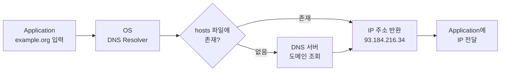
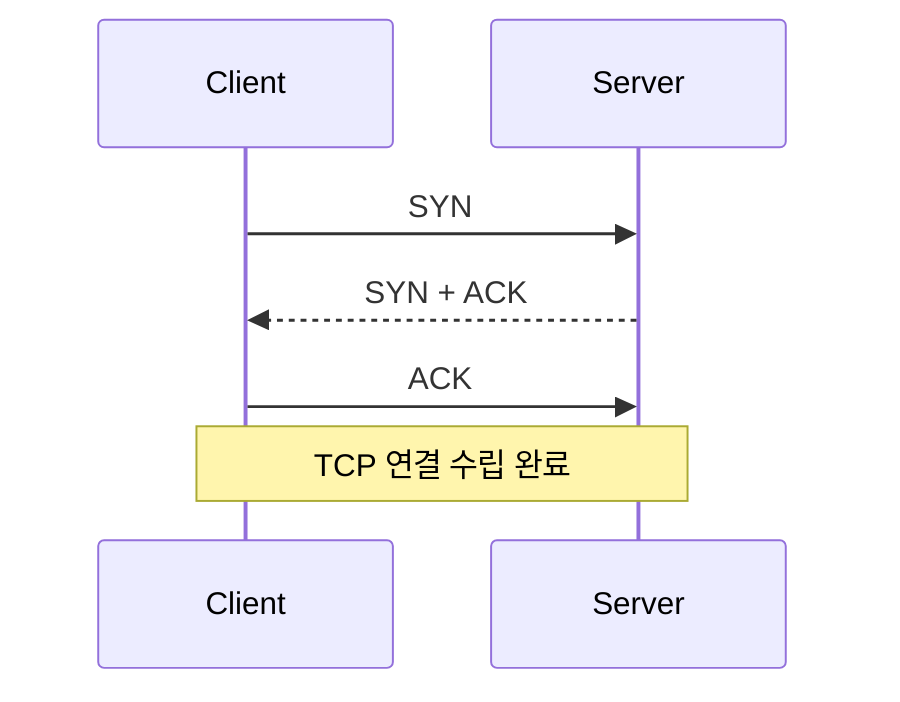
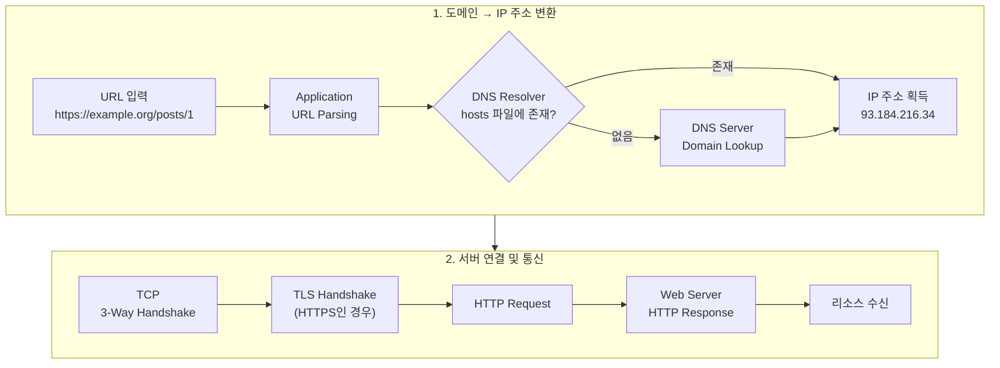

### 도메인 주소 입력부터 서버 연결까지

사용자가 웹 브라우저나 애플리케이션에 주소를 입력하면 해당 주소를 이용해 서버와 통신하는 과정이 시작됨

하지만 컴퓨터는 도메인 이름이 아니라 IP 주소를 이용해 네트워크 통신을 수행함

→ 변환하는 시스템이 DNS(Domain Name System)

<br/>

다음과 같은 URL이 있다고 가정함

```
https://example.org/posts/1
```

URL은 다음과 같이 구분할 수 있음

- `https`
    - Scheme
    - 리소스에 접근하는 방식
- `example.org`
    - Host
    - 서버의 도메인 이름
- `/posts/1`
    - Path
    - 서버에서 요청할 리소스 경로
- `etc..`
    - 선택적으로 쓸 수 있는 `Port` , `Query` , `Fragment` 등이 있음
    - `Port` 생략시 Scheme에 따른 기본 포트가 사용됨
        - `https` → 443
        - `http` → 80

이 중 DNS 조회의 대상은 `example.org` 에 해당하는 Host임

즉, URL 전체를 IP 주소로 변환하는 것이 아니라 서버의 위치를 찾기 위해 도메인 이름을 IP 주소로 변환하는 것임

<br/>
<br/>

### DNS

사용자가 `example.org` 라는 도메인을 입력하면 애플리케이션은 해당 도메인의 IP 주소를 알아내기 위해 OS의 이름 해석 기능에 조회를 요청함

→ OS는 DNS Resolver를 통해 도메인 이름을 조회

이때 DNS Resolver는 바로 외부에 물어보지 않고, 먼저 내 컴퓨터 안에 정보가 있는지부터 확인함

<br/>

대표적인 것이 `hosts`  파일임

`hosts` 파일은 도메인과 IP 주소를 직접 적어둔 로컬 파일로, 여기에 정보가 있으면 DNS 서버에 묻지 않고 그 IP를 바로 사용함

```powershell
# MacOS 기준
~ > cat /etc/hosts
##
# Host Database
#
# localhost is used to configure the loopback interface
# when the system is booting.  Do not change this entry.
##
127.0.0.1       localhost
255.255.255.255 broadcasthost
::1             localhost
```

`localhost` 가 `127.0.0.1` 로 연결되는 것도 `hosts` 파일에 적혀 있기 때문임

하지만 대부분의 도메인은 `hosts` 파일에 없기 때문에 이 경우 DNS Resolver는 설정된 DNS 서버에 조회를 요청함

DNS 서버는 해당 도메인에 대응하는 IP 주소를 찾아 돌려주고, DNS Resolver는 이 결과를 애플리케이션에 전달함

<br/>

전체 흐름은 다음과 같음



즉 OS가 모든 도메인과 IP 주소를 가지고 있는 것이 아니라, 로컬에서 먼저 찾아보고 없으면 DNS 서버에 대신 물어봐 주는 역할을 하는 것임

<br/>
<br/>

### DNS Server

대표적인 DNS 서버는 다음과 같음

- Google DNS
    - `8.8.8.8`
- Cloudflare DNS
    - `1.1.1.1`

DNS 서버는 요청받은 도메인에 대응하는 IP 주소를 조회하고 그 결과를 반환함

이 과정에서 DNS 서버는 캐시된 정보를 활용하거나 다른 DNS 서버에 추가로 조회를 요청할 수 있음

<br/>

DNS 조회가 완료되면 애플리케이션은 다음과 같은 IP 주소를 전달받게 됨

```
example.org → 93.184.216.34
```

이제 애플리케이션은 도메인 이름이 아닌 IP 주소를 이용해 실제 서버와 연결할 수 있음

<br/>
<br/>

### TCP Connection

하지만 IP 주소를 알아냈다고 해서 서버와 통신할 수 있는 상태가 된 것은 아님

실제 데이터를 주고받기 위해서는 서버와 네트워크 연결을 수립해야 함

일반적으로 TCP를 사용하는 경우 3-Way Handshake 과정을 통해 연결을 수립함

<br/>

TCP 연결은 다음과 같은 순서로 진행됨

- **SYN**
    - 클라이언트가 서버에 연결 요청
- **SYN-ACK**
    - 서버가 연결 요청에 응답
- **ACK**
    - 클라이언트가 응답을 전달

이 과정을 완료하면 클라이언트와 서버 사이에 TCP 연결이 수립됨

<br/>

그림으로 보면 다음과 같음



여기서 TCP 연결을 수립할 때는 IP 주소뿐만 아니라 포트 번호도 필요함

- **IP 주소**
    - 통신할 서버를 식별
- **Port**
    - 해당 서버에서 통신할 애플리케이션의 접점을 식별

예를 들어 HTTPS 통신은 일반적으로 443번 포트를 사용함

→ URL에 포트를 적지 않아도 Scheme을 보고 기본 포트가 자동으로 정해지는 것임

<br/>
<br/>

### HTTP Request/Response

TCP 연결이 완료되면 클라이언트와 서버가 데이터를 주고받을 수 있는 상태가 됨

이후 HTTP 프로토콜을 사용하는 경우 클라이언트는 서버에 HTTP Request를 전송함

서버는 요청을 처리한 후 HTTP Response를 반환함

```
Client → Server

GET /posts/1 HTTP/1.1
Host: example.org

Server → Client

HTTP/1.1 200 OK
Content-Type: application/json

{
  "id": 1,
  "title": "Hello World"
}
```

이러한 과정을 통해 클라이언트는 서버에서 제공하는 리소스를 전달받을 수 있음

HTTPS의 경우 TCP 연결 이후 TLS Handshake 과정이 추가되며, 그 후 암호화된 HTTP 통신이 이루어짐

<br/>

지금까지 정리한 전체 흐름은 다음과 같음



<br/>