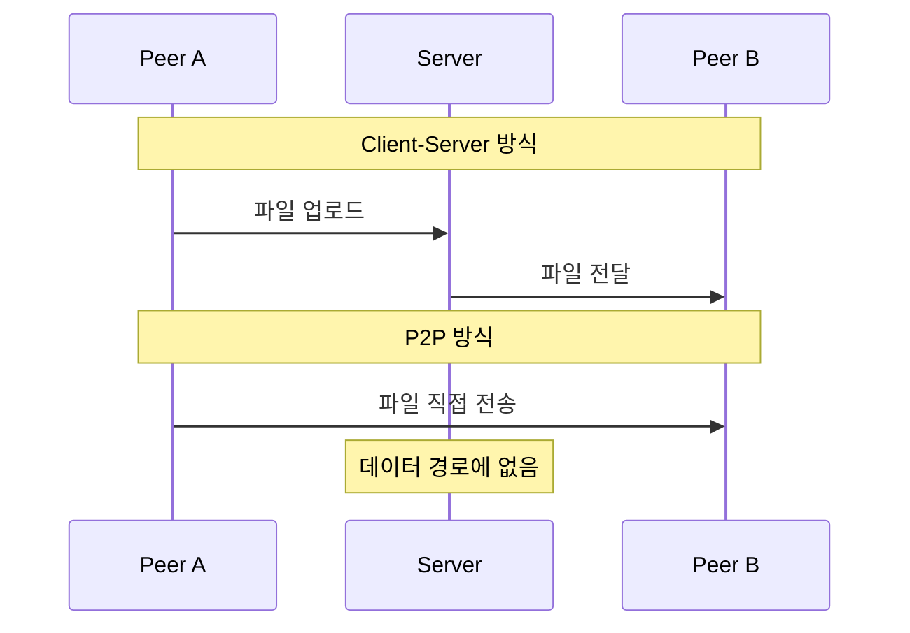
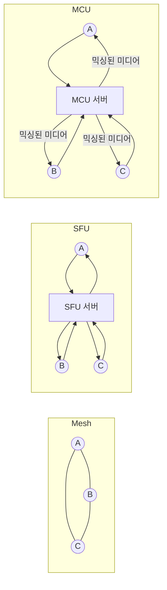
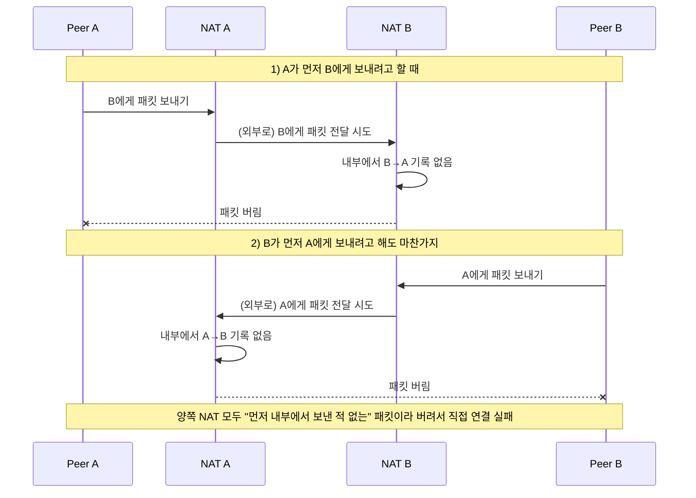
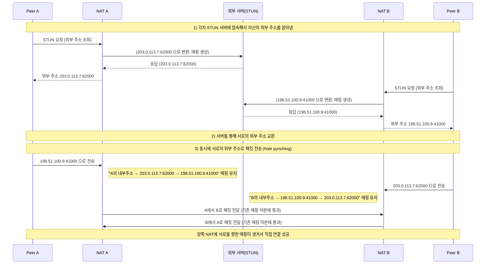
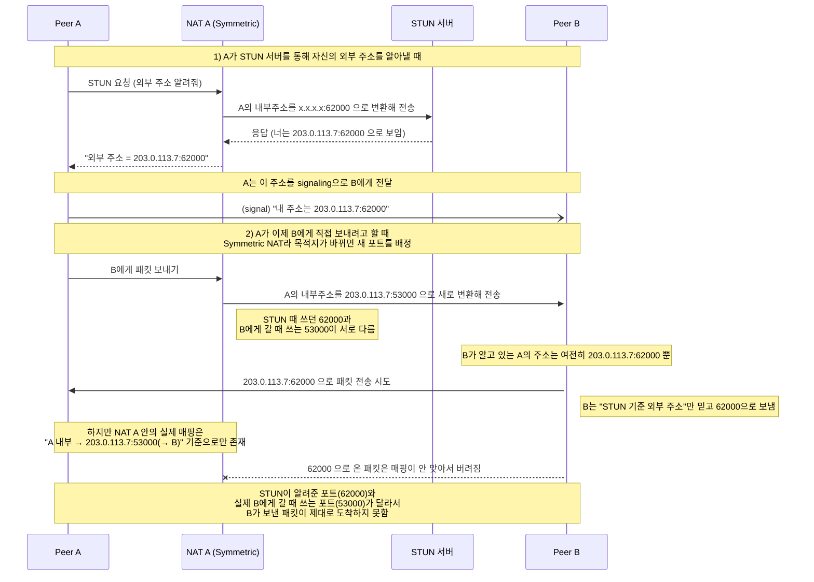

### P2P란?

P2P(Peer-to-Peer)는 중앙 서버를 거치지 않고 각 컴퓨터가 서로 직접 데이터를 주고받는 통신 구조를 말함

기존 웹은 대부분 Client-Server 구조로 다음과 같은 문제가 존재함

- 모든 데이터가 서버를 지나 서버 트래픽·저장 비용이 계속 늘어남
- 서버를 한 번 더 거치는 만큼 지연이 발생
- 서버가 죽으면 통신 불가
- 데이터가 서버에 남거나 서버 운영자가 볼 수 있음

 

그림으로 보면 다음과 같음

P2P에서는 Peer가 클라이언트이면서 동시에 서버 역할을 함

→ 요청을 보내기도 하고, 상대의 요청에 응답하기도 함

 

Client-Sever와 P2P 두 구조는 장단점이 반대에 가까움

| **항목** | **Client-Server** | **P2P** |
| --- | --- | --- |
| 데이터 경로 | 항상 서버 경유 | peer끼리 직접 |
| 서버 부하·비용 | 사용자·데이터 양에 비례해 증가 | 데이터 중계 비용 거의 없음 (연결 도움 서버는 필요할 수 있음) |
| 지연 | 서버 왕복만큼 추가 | 가까운 peer끼리는 짧음 |
| 장애점(SPOF) | 서버가 단일 장애점 | 특정 peer가 꺼져도 나머지는 동작 |
| 상대가 오프라인일 때 | 서버에 저장해 두면 나중에 받을 수 있음 | 상대가 켜져 있어야만 통신 가능 |
| 통제·감사 | 서버에서 한곳에 모아 관리 쉬움 | 데이터가 흩어져 있어 중앙 관리 어려움 |
| 연결 난이도 | 서버 주소만 알면 됨 | NAT·방화벽 때문에 연결 자체가 어려움  |

이때 상대가 오프라인이면 통신할 수 없다는 점은 P2P의 본질적인 성질로 서버에 보관하지 않는 대신 얻는 장점의 대가라 설계할 때 반드시 화면에서 어떻게 보여줄지 정해야 함

 
 

### P2P의 종류

P2P라고 해서 항상 서버가 전혀 없는 것이 아니라 서버가 어디까지 개입하느냐에 따라 크게 나뉨

- **순수 P2P**
    - 중앙 서버가 없음
    - Peer와 Peer 찾기를 서로 해야함
    - 서버 의존이 없지만 처음 접속할 Peer 찾기가 어려움
- **하이브리드 P2P**
    - 서버는 Peer 목록 제공과 연결 정보 교환만 담당하고 실제 데이터는 Peer끼리 직접 주고받음
    - 예시로는 WebRTC가 있음

보통 실무에서 많이 사용되는 P2P는 하이브리드 P2P 방식임

 
 

### P2P 연결 토폴로지

Peer가 2명이면 연결 하나로 끝나지만, 3명 이상이 되면 어떻게 연결할지 정해야 함

토폴로지는 여러 Peer를 어떤 연결 구조로 묶어둘지를 뜻함

즉, 각 Peer를 누구와 누구 사이를 직접 연결해 둘지에 따라 전체 네트워크 구조가 달라지고, 그에 따라 필요한 연결 수, 트래픽이 가는 경로, 서버 부담 등이 달라짐

 

화상회의 같은 다자간 통신에서 주로 다음 세 가지를 비교함

- **Mesh**
    - 모든 Peer가 모든 Peer와 직접 연결함
    - Peer가 n명이면 연결 수는 n(n-1)/2개 임
    - 각 Peer가 n-1명에게 같은 데이터를 따로 보내야 해서 Peer가 늘수록 업로드가 감당이 안 됨
- **SFU - Selective Forwarding Unit**
    - 각 Peer는 서버에 한 번만 보내고, 서버가 다른 Peer들에게 그대로 전달함
    - 서버가 데이터를 섞지 않고 골라서 넘겨주기만 함
        - 서버가 라우터처럼 받아서 필요한 것만 골라 돌려보내는 방식이라 생각하면 됨
- **MCU - Multipoint Control Unit**
    - 서버가 모든 영상을 받아서 하나로 합친 뒤 각 Peer에게 하나만 보냄
    - Peer는 편하지만 서버 CPU 비용이 큼

 

그림으로 보면 다음과 같음

 
 

### P2P가 어려운 이유: NAT

P2P가 장점이 많은데도 흔하지 않은 이유는, 상대에게 직접 연결하는 것 자체가 어렵기 때문임

이 어려움의 핵심에 NAT라는 장치가 있음

 

이를 알기 위해선 먼저 주소 개념부터 알아야함

- **공인 IP**
    - 인터넷에서 유일한 주소로 외부에서 바로 찾아올 수 있음
    - 예) `203.0.113.7`
- **사설 IP**
    - 회사, 집 내부망에서만 쓰는 주소
    - 예) `192.168.0.10` , `10.0.0.5`
    - 다른 외부에서도 똑같은 `192.168.0.10` 이 있을 수 있으므로 외부에서 이 주소로는 찾아올 수 없음

대부분의 PC, 휴대폰은 이런 사설 IP를 쓰고, 공유기나 회사 방화벽만 공인 IP를 가짐

여기서 NAT가 등장함

 

NAT는 내부의 사설 IP를 공유기, 방화벽의 공인 IP로 바꿔서 인터넷에 내보내는 장치임

내부 PC가 밖으로 패킷을 보내면 NAT가 다음처럼 변환 표를 만들어 둠

| **내부 주소** | **→** | **외부에서 보이는 주소** | **목적지** |
| --- | --- | --- | --- |
| `192.168.0.10:5000` | → | `203.0.113.7:62000` | `198.51.100.20:3478` |

응답이 `203.168.0.10:5000` 으로 돌아오면 NAT가 표를 보고 `192.168.0.10:5000` 으로 넘겨줌

 

하지만 NAT에는 중요한 규칙이 존재함

내부에서 먼저 보낸 적이 없는 외부 패킷은 버린다는 것임

→ 안에서 먼저 나간 요청의 응답만 들어올 수 있음

그래서 A와 B가 둘 다 집·회사 NAT 뒤에 있을 때 문제가 발생함

 

그림으로 보면 다음과 같음

 
 

### NAT Traversal - hole punching 방식

NAT Traversal은 NAT 뒤에 있는 Peer끼리 연결할 방법을 찾는 기법을 통들어 말함

가장 대표적인 방법이 UDP hole punching임

 

원리는 단순함

- A와 B가 각각 외부 서버에 패킷을 보내서 자신의 외부 주소를 알아냄
- 서버를 통해 서로의 외부 주소를 교환함
- A와 B가 동시에 상대의 외부 주소로 패킷을 보냄
- 각자의 NAT에는 상대 외부 주소로 보낸 기록이 존재하므로 통과시킴

즉, 상대 패킷이 들어올 수 있도록 자기 NAT에 매핑을 먼저 만들어 두는 방식임

 

그림으로 보면 다음과 같음

하지만 NAT가 목적지마다 다른 포트를 배정하면 문제가 발생함

 

그림으로 보면 다음과 같음

실제 환경에서는 이 문제를 피하려고 보통 세 가지를 같이 씀

- `STUN`
    - 내 외부 주소를 알아내는 서버
- `TURN`
    - 끝까지 직접 연결이 안 될 때 대신 데이터를 중계해 주는 서버
- `ICE`
    - 가능한 모든 후보 경로를 모아서,  실제로 통하는 경로를 자동으로 골라내는 절차

WebRTC는 이 세 가지를 브라우저 안에 이미 구현해 두었음

 