### Overview

ERD를 이해하려면 먼저 데이터베이스가 데이터를 저장하는 방식을 이해해야 함

그다음 데이터 관리 대상인 엔티티와 속성을 정의하고, 엔티티 사이의 관계를 표현한 ERD를 읽음

프론트엔드에서는 이 정보를 화면과 유저 플로우 설게에 활용함

<br/>
<br/>

### What is Database?

데이터베이스는 데이터를 지속적으로 저장하고 조회·수정·삭제할 수 있도록 관리하는 저장소임

관계형 데이터베이스 RDB는 데이터를 테이블로 구성하고, 테이블 사이의 관계를 키로 연결함

<br/>

일반적인 웹 서비스에서 프론트엔드는 데이터베이스에 직접 접속하지 않고 API 서버를 통해 데이터를 조회하거나 변경함

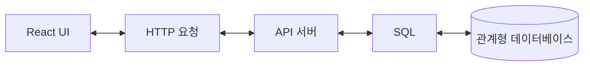

데이터베이스의 제약 조건을 위반한 요청은 서버의 검증과 DB 제약 조건에 의해 거부될 수 있음

<br/>
<br/>

### 테이블의 기본 용어

테이블은 데이터를 행과 열로 구성하여 저장하는 구조임

관계형 데이터베이스의 이론적 관점에서는 테이블에 대응하는 개념을 릴레이션이라고 함

<br/>

둘의 개념을 정확하게 짚고넘어가자면 다음과 같음

- **테이블**
    - 실제 데이터베이스에서 데이터를 저장하고 관리하는 구조를 표현하는 실무적 개념
- **릴레이션**
    - 관게형 데이터 모델에서 정의하는 수학적 개념으로, 행의 집합을 의미함

→ 실제 DBMS의 테이블에는 행의 순서가 존재할 수 있지만, 릴레이션은 튜플의 순서를 고져랗지 않음

정리하자면 테이블은 릴레이션을 실제 데이터베이스에서 구현한 구조인 것임

<br/>

사용자 정보를 저장하는 `User` 테이블을 통해 테이블의 기본 용어를 알아볼 것임

| **user_id** | **name** | **email** |
| --- | --- | --- |
| 1 | 민수 | minsu@example.com |
| 2 | 영희 | younghee@example.com |
| 3 | 철수 | chulsoo@example.com |
- **열**
    - 저장할 데이터 항목
    - `name`
- **속성**
    - DBMS 모델에서 엔티티/릴레이션의 특성을 나타내는 항목
    - 테이블에서는 열에 대응
- **행**
    - 실제 데이터 한 건
    - 민수의 사용자 정보
- **튜플**
    - 행 한 건을 가리키는 용어
    - `1` , `민수` , `minsu@example.com`

중요한건 열은 데이터의 종류, 행은 실제 데이터 한 건, 값은 해당 칸에 저장된 내용이라는 것임

<br/>

JavaScript 객체 배열과 테이블을 연결하자면 다음과 같음

```tsx
const members = [
	{ id:1, name: '민수', email: 'minsu@example.com' },
	{ id:2, name: '영희', email: 'younghee@example.com' },
];
```

- 테이블 → `members` 배열
- 행 → 배열 안의 객체 하나
- 열 → 객체의 `key` 와 대응하는 데이터 항목

<br/>
<br/>

### Key와 제약 조건

Key는 행을 식별하거나 테이블 간의 관계를 연결하는 데 사용하는 속성 또는 속성의 조합임

주요 키 종류로는 다음이 있음

| **키** | **정의** | **예시** |
| --- | --- | --- |
| 기본 키 (PK) | 테이블의 각 행을 고유하게 식별하는 키. 중복과 NULL을 허용하지 않음 | `User.user_id` |
| 외래 키 (FK) | 다른 테이블의 후보 키를 참조하여 관계와 참조 무결성을 표현하는 키 | `Orders.user_id` |
| 후보 키 (Candidate Key) | 행을 고유하게 식별할 수 있고, 최소성을 만족하는 속성 또는 속성 조합. PK로 선택 가능 | 고유한 `user_id`, `email` |
| 대체 키 (Alternate Key) | 후보 키 중 PK로 선택되지 않은 키 | PK가 user_id일 때 email |
| 복합 키 (Composite Key) | 둘 이상의 속성을 조합해 식별하는 키 | `(order_id, product_id)` |
| 슈퍼키 (Superkey) | 행을 고유하게 식별할 수 있는 속성 또는 속성 조합. 불필요한 속성이 포함될 수 있음 | `user_id`, `(user_id, name)` |

<br/>

PK키와 FK키의 차이는 다음과 같음

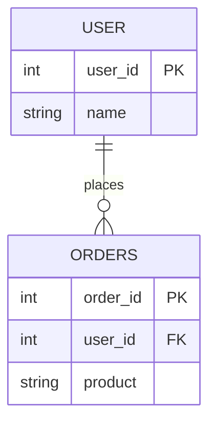

- `User.user_id`
    - 사용자 행 식별 → PK
    - PK이기에 중복 불가능
- `Orders.order_id`
    - 주문 행 식별 → PK
    - PK이기에 중복 불가능
- `Orders.user_id`
    - 주문이 속한 사용자 참조 → FK
    - FK이기에 중복 가능

<br/>

FK는 `NULL` 허용 여부와 참조 대상의 고유성 등 제약 조건에 따라 동작함

제약 조건으로는 다음이 있음

| **제약 조건** | **의미** | **화면 설계에서 확인할 점** |
| --- | --- | --- |
| `PRIMARY KEY` | 고유 식별자이며 `NULL` 불가 | 보통 생성 폼에서 ID를 직접 입력하지 않음 |
| `FOREIGN KEY` | 참조 대상이 존재하도록 보장 | 자유 입력보다 검색·선택 UI가 적합할 수 있음 |
| `NOT NULL` | 값 필수 | 필수 표시와 입력 검증 |
| `UNIQUE` | 중복 금지 | 중복 검사 및 서버 오류 처리 |
| `DEFAULT` | 값을 생략했을 때 기본값 | 초기값과 선택 입력 여부 확인 |
| `CHECK` | 값의 조건을 검사 | 최솟값·최댓값 등 입력 검증 |

이때, `NULL` 과 빈 문자열 `“”` 은 다름

`NULL` 은 값이 없거나 알려지지 않은 상태를 의미하고, 빈 문자열은 길이가 0인 문자열임

<br/>
<br/>

### 스키마와 데이터

데이터베이스에 데이터를 저장하려면 먼저 데이터의 구조와 저장 규칙을 정의해야 함

SQL에서는 `CREATE TABLE` 로 테이블을 생성하고, `INSERT` 로 실제 데이터를 추가함

```sql
CREATE TABLE users (
	user_id INTEGER PRIMARY KEY,
	name VARCHAR(100) NOT NULL,
	email VARCHAR(255) UNIQUE
);
```

`CREATE TABLE` 은 테이블의 구조와 제약 조건을 정의하는 DDL임

→ Data Definition Language, 데이터 정의어

<br/>

위 SQL은 `users` 테이블을 생성하면서 다음 규칙을 정의함

| 컬럼 | 데이터 타입 | 제약 조건 | 의미 |
| --- | --- | --- | --- |
| `user_id` | `INTEGER` | `PRIMARY KEY` | 각 행을 고유하게 식별함 |
| `name` | `VARCHAR(100)` | `NOT NULL` | 최대 100자까지 저장하며, `NULL`을 허용하지 않음 |
| `email` | `VARCHAR(255)` | `UNIQUE` | 중복된 값을 허용하지 않음 |

이 시점에는 테이블의 구조만 정의되어 있으며, 실제 사용자 데이터는 저장되지 않은 상태임

<br/>

`INSERT` 는 테이블에 실제 데이터를 추가하는 DML임

→ Data Manupulation Language, 데이터 조작어

```sql
INSERT INTO users (user_id, name, email)
VALUES (1, "민수", "minsu@example.com'):
```

<br/>

위 SQL을 실행하면 `users` 테이블에 다음과 같은 행이 추가됨

| user_id | name | email |
| --- | --- | --- |
| 1 | 민수 | minsu@example.com |

삽입하려는 데이터는 앞서 정의한 구조와 제약 조건을 만족해야 함

`name` 에 `NULL` 을 입력하거나 이미 사용 중인 `user_id` 를 다시 입력하면 제약 조건 위반으로 삽입이 실패할 수 있음

<br/>

스키마는 데이터가 어떤 구조와 규칙으로 저장되는지를 정의한 것임

데이터는 그 구조 안에 실제로 저장되는 값임

두 개념의 차이는 `users` 테이블을 기준으로 구분할 수 있음

| 구분 | 의미 | 예시 |
| --- | --- | --- |
| 스키마 | 테이블의 구조와 규칙 | `user_id` 컬럼이 존재하고, 기본 키로 지정되어 있음 |
| 데이터 | 테이블에 실제 저장된 값 | `1`, `'민수'`, `'minsu@example.com'` |

<br/>

앞서 작성한 SQL을 기준으로 보면 다음과 같음

- `CREATE TABLE`
    - 스키마를 정의함
- `INSERT`
    - 정의된 스키마에 따라 데이터를 추가함
- `ALTER TABLE`
    - 기존 테이블의 구조를 변경함
- `UPDATE` , `DELETE`
    - 기존에 저장된 데이터를 수정하거나 삭제함

즉, 스키마는 데이터가 저장되는 방식과 규칙을 정의하고, 데이터는 그 규칙에 따라 실제로 저장되는 값임

<br/>
<br/>

### 엔티티와 ERD

엔티티는 시스템에서 독립적으로 식별하고 관리할 가치가 있는 대상임

예를 들어 사용자, 상품, 주문, 부서, 기기 등이 엔티티가 될 수 있음

보통 엔티티 하나가 테이블 하나로 구현되는 경우를 기준으로 이해하는게  쉬움

→ 단 모든 설계에서 둘이 반드시 1:1로 대응하는 것은 아님

<br/>

ERD는 엔티티, 속성, 키, 엔티티 간 관계를 표현한 다이어그램임

테이블을 화면에 그대로 옮기기 위한 그림이 아니라, 데이터 구조와 제약을 이해하기 위한 모델임

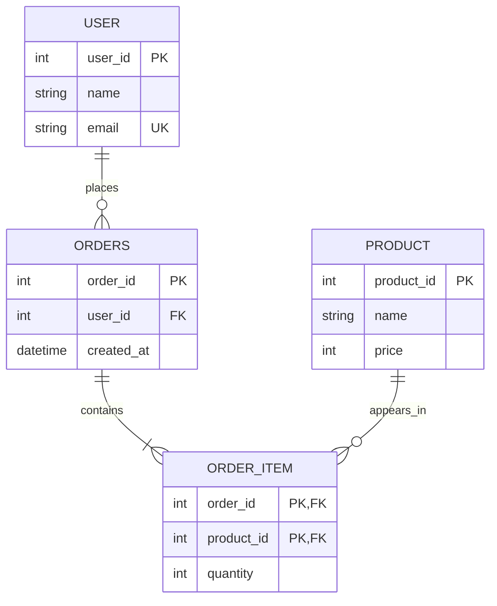

<br/>

이때 모델은 세 단계로 나뉘어짐

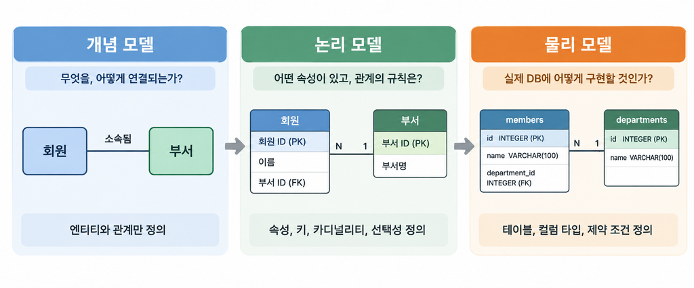

- **개념 모델**
    - 엔티티와 관계
- **논리 모델**
    - 속성, 키, 카디널리티, 선택성
- **물리 모델**
    - 실제 테이블, 컬럼 타입, 인덱스, DMBS 제약

<br/>
<br/>

### 관계와 카디널리티

관계는 엔티티 사이의 연결을 뜻함

- **A 하나에 B가 최대 몇 개 연결될 수 있는가?**
- **B 하나에 A가 최대 몇 개 연결될 수 있는가?**

관계를 정확하게 이해하기 위해선 양방향으로 읽어야함

<br/>

이를 나타내기 위해 까마귀발 표기법을 사용함

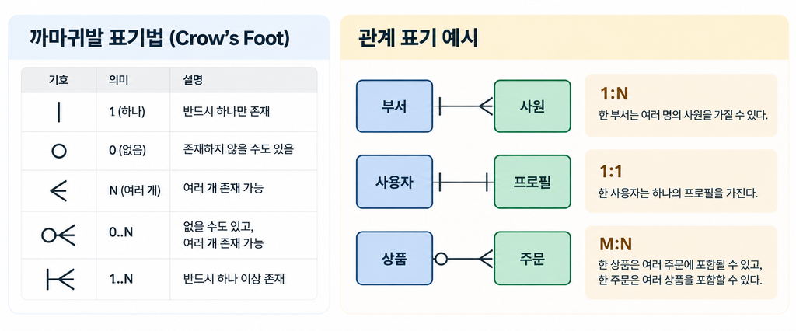

<br/>

가장 먼저 알아볼 것은 1:1 관게임

한쪽의 한 인스턴스가 반대쪽의 최대 한 인스턴스와 연결됨

각 방향에서 최소 개수가 0인지 1인지도 별도로 확인해야 함

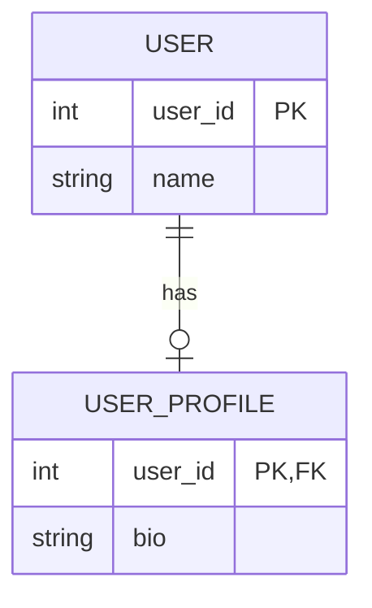

위 표기에서는 사용자는 프로필을 0개 또는 1개 가질 수 있고, 프로필은 정확히 한 사용자에게 속함

<br/>

다음은 1:N 관계임

한쪽 인스턴스에 반대쪽 인스턴스가 여러 개 연결될 수 있고, 반대쪽 인스턴스는 한쪽의 한 인스턴스에 연결되는 관계임

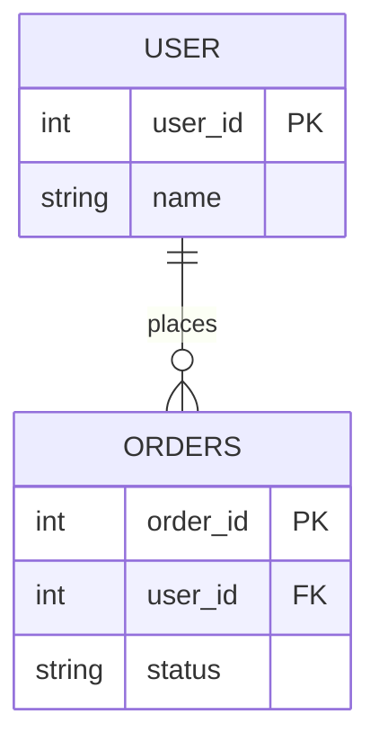

사용자는 주문을 0개 이상 만들 수 있고, 주문은 사용자 한 명에게 속함

일반적으로 FK는 여러 행이 생길 수 있는 N쪽에 둠

→ 위 예시에서는 `Orders.user_id`

<br/>

마지막으로 M:N 관계임

양쪽 인스턴스가 서로 여러 개와 연결될 수 있는 관계임

관계형 DB에서는 보통 연결 테이블 또는 연결 엔티티를 사용해 두 개의 1:N 관게로 구현함

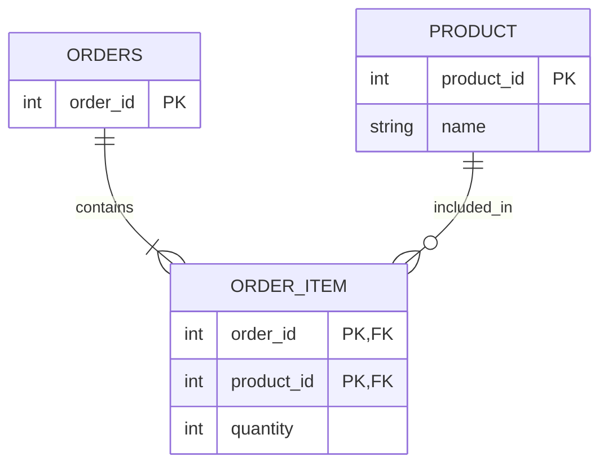

`ORDER_ITEM` 은 주문과 상품의 연결을 저장함

`quantity` 처럼 연결 자체에 속성이 있다면 중간 테이블은 단순한 연결 이상의 의미를 가짐

<br/>
<br/>

### 테이블을 연결해서 조회하기

테이터를 여러 테이블로 나누면 같은 사실을 반복 저장하는 문제를 줄일 수 있음

대신 화면에 여러 테이블의 정보를 함께 보여주려면 조회 시 연결해야 하며, 이를 `JOIN` 이라고 함

<br/>

예시 테이블은 다음과 같음

| **User.user_id** | **User.name** |
| --- | --- |
| 1 | 민수 |
| 2 | 영희 |

| **Orders.order_id** | **Orders.user_id (FK)** | **product** |
| --- | --- | --- |
| 501 | 1 | 키보드 |
| 502 | 1 | 마우스 |
| 503 | 2 | 모니터 |

`Orders` 테이블의 `user_id` 와 사용자 테이블의 `user_id` 가 같은 행을 연결해 주문 정보와 사용자 이름을 함께 조회함

<br/>

SQL로 구현하면 다음과 같이 사용됨

```sql
SELECT
	o.order_id,
	o.product,
	u.name AS user_name
FROM Orders AS o
JOIN User AS u
	ON u.user_id = o.user.id;
```

<br/>

JavaScript로 비교하자면 다음과 같음

```tsx
const result = orders.map(order => ({
	orderId: order.order_id,
	product: order.product,
	userName:
		user.find(user => user.user_id === order.user_id)?.name ?? null,
}));
```

<br/>
<br/>

### 정규화와 반정규화

서로 다른 대상의 정보를 한 테이블에 반복 저장하면 갱신·삽입·삭제 과정에서 이상 현상이 발생할 수 있음

정규화는 중복과 의존 관계의 문제를 줄이도록 데이터를 구조화하는 과정임

<br/>

만약 다음과 같은 테이블이 있을때

| **device_name** | **member_name** | **member_email** | **department_name** |
| --- | --- | --- | --- |
| 노트북-01 | 김하늘 | sky@example.com | 영업팀 |
| 노트북-02 | 김하늘 | sky@example.com | 영업팀 |
| 데스크탑-07 | 최별 | star@example.com | 개발팀 |

김하늘의 이메일이나 영업팀의 이름이 바뀌면 여러 행을 수정해야 함

→ 일부 행만 변경하면 데이터가 서로 불일치할 수 있음

<br/>

이를 해결하고자 구성원 정보는 `MEMBER` 에, 부서 정보는 `DEPARTMENT` 에 저장하고 `DEVICE` 에는 각 대상을 참조하는 `ID` 를 둠

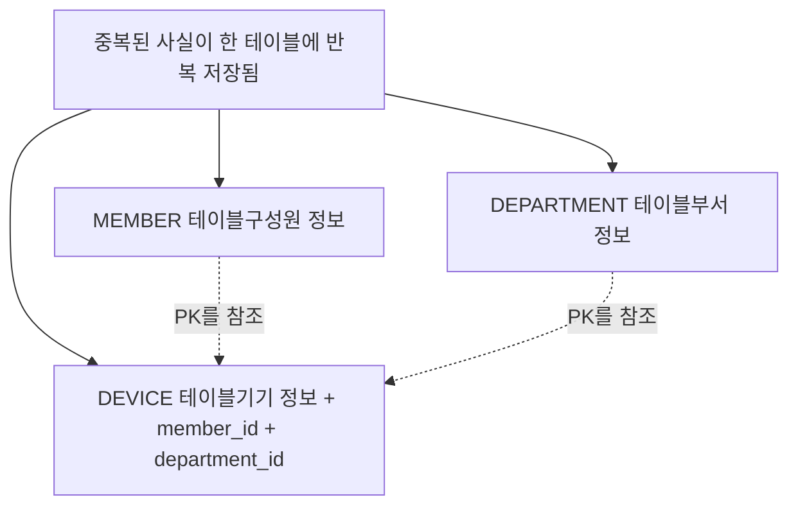

이 방식은 중복을 줄이고 변경의 기준점을 명확하게 함

<br/>

반정규화는 조회 성능이나 이력 보존 등의 이유로 데이터를 의도적으로 중복 저장하는 방식임

둘의 차이는 다음과 같음

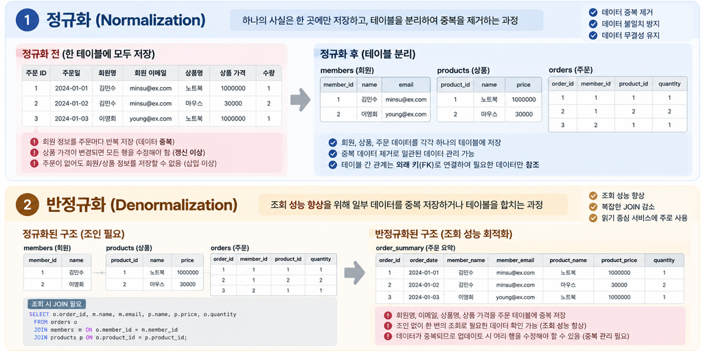

<br/>
<br/>

### ERD에서 화면 설계로 연결하기

ERD를 화면에 1:1로 옮기면 테이블마다 CRUD 화면을 만드는 구조가 될 수 있음

화면은 테이블 자체가 아니라 사용자가 수행하는 작업과 데이터의 생명주기를 기준으로 설계해야 함

<br/>

다음과 같이 기기 관리 화면을 설계해야 한다 고 가정할때 ERD는 다음과 같음

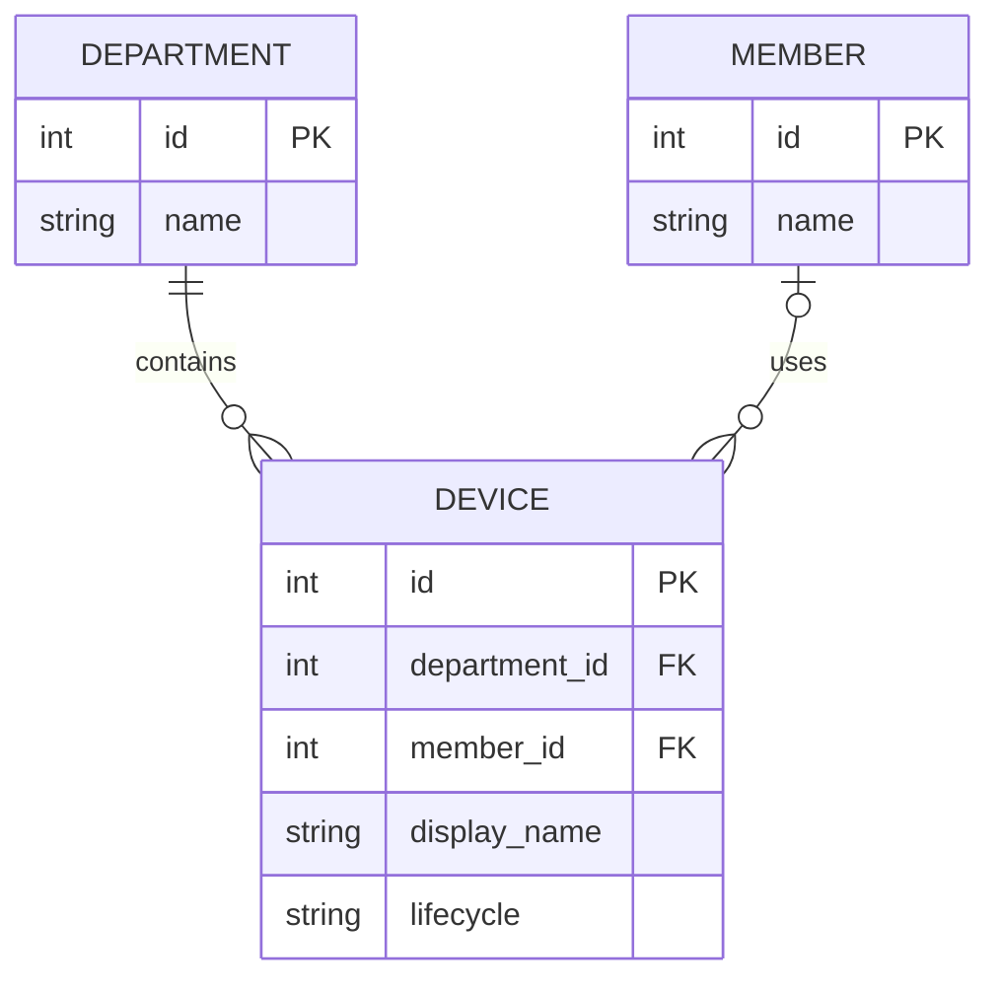

이 관계에서 화면 설계 질문을 도출할 수 있음

- **부서가 없으면 기기를 등록할 수 없는가?**
    - 기기 등록 전에 부서를 생성하도록 안내
- **사용자가 지정되지 않은 기기는 가능한가?**
    - 목록에 미지정 또는 공용 기기 상태를 표시
- **부서를 삭제할 때 기기는 어떻게 되는가?**
    - 삭제 제한 또는 이동 정책을 백엔드와 확인
- **기기 수가 많아질 수 있는가?**
    - 규모에 따라 서버 페이지네이션과 검색을 검토

<br/>

화면 설계로 이어지는 전체 절차는 다음과 같음

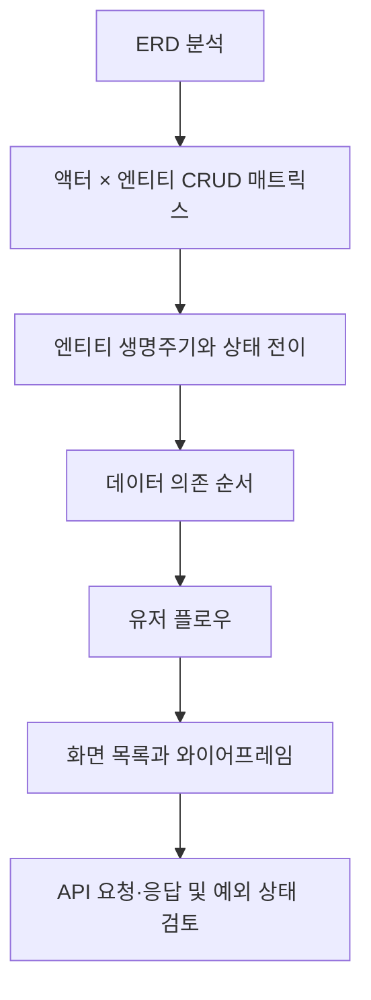

<br/>